Dạy người lớn 23+ thì mình quen rồi. Dạy các bạn 7 tuổi thì... ôi nó KHÁC lắm luôn. Đau đầu, mà là đau đầu một cách rất đáng yêu.

Hôm đó Hà Nội bụp một phát đón cái lạnh đầu mùa. Cũng là lần đầu tiên ông Dũng đứng lớp cho các bạn nhỏ lớp 2B0, lớp của con gái mình.

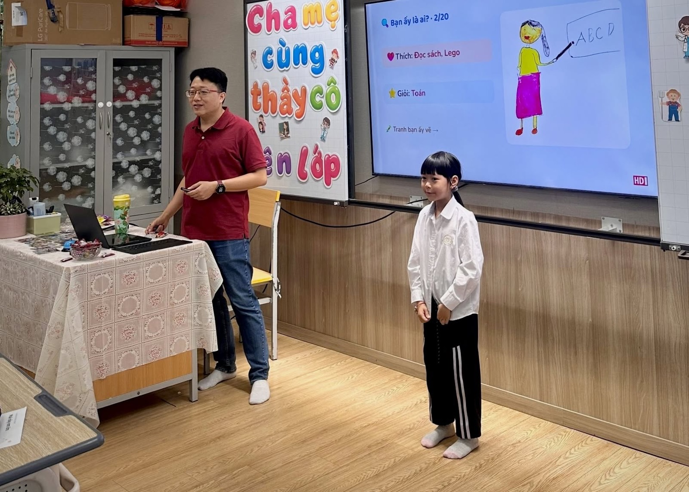

Đây là chương trình "Cha mẹ cùng thầy cô lên lớp" của Hệ thống giáo dục May Academy. Cảm ơn nhà trường vì chương trình rất thú vị này. Và cảm ơn các phụ huynh khác đã liều mình giao con cho ông Dũng trong (những) 40 phút lận :D

Nội dung buổi sinh hoạt trải nghiệm thì được cả vợ và con gái gợi ý và xét duyệt, nên chắc là cũng ok lah.

Toàn bộ slide của buổi học đây:

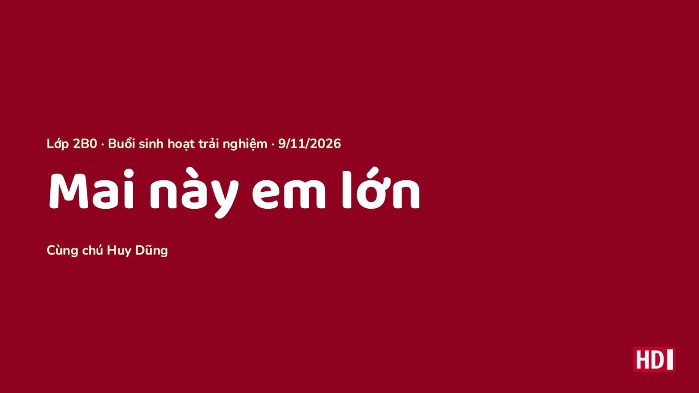

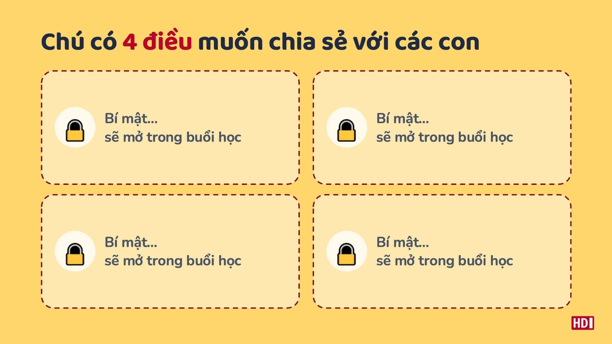

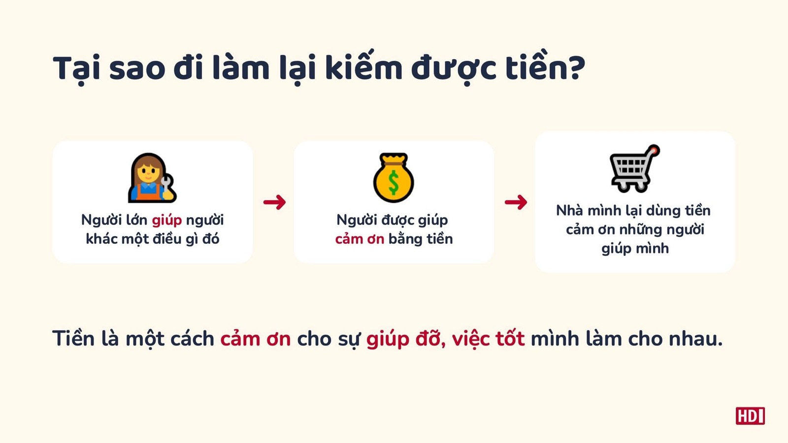

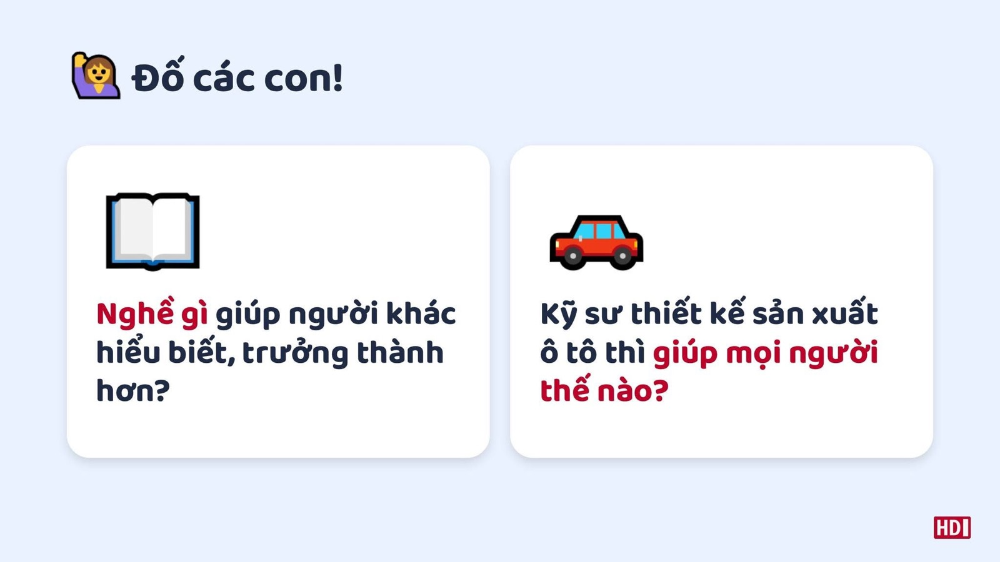

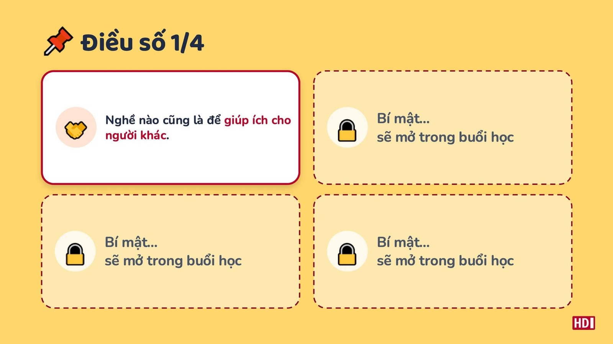

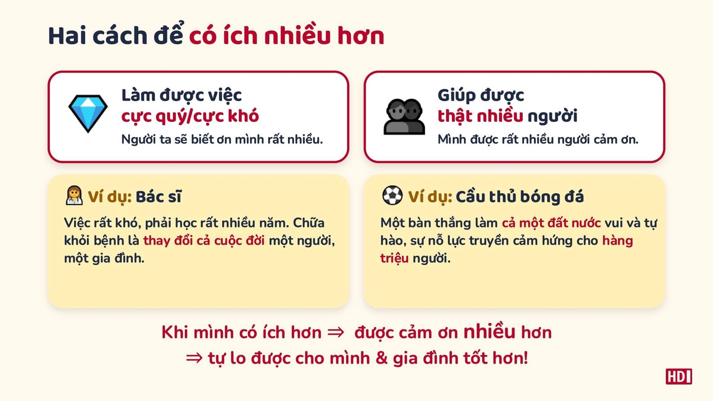

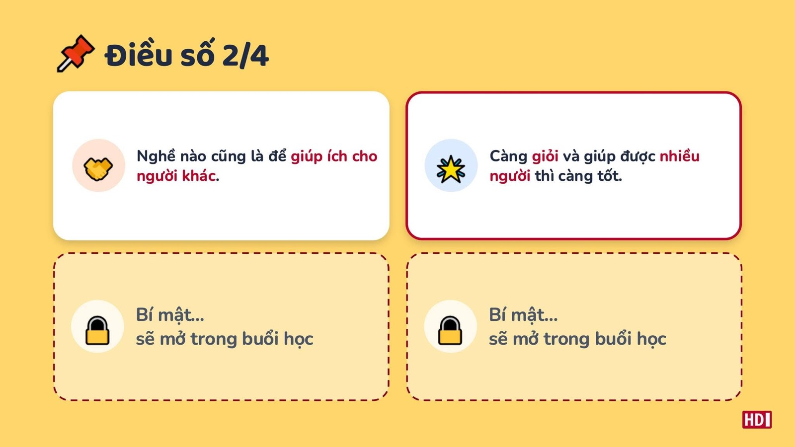

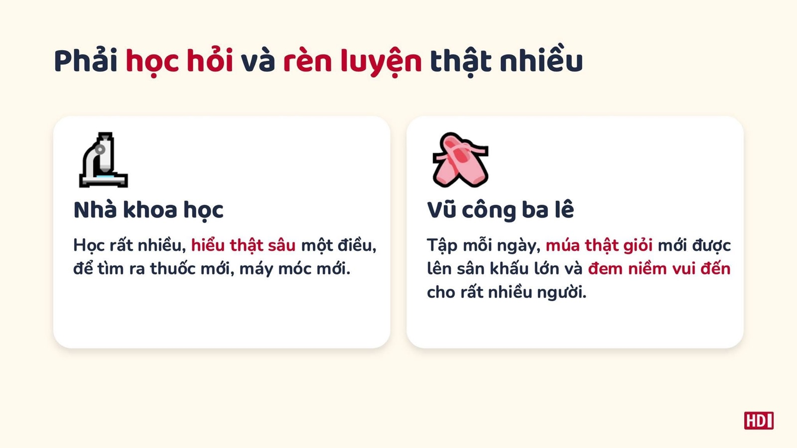

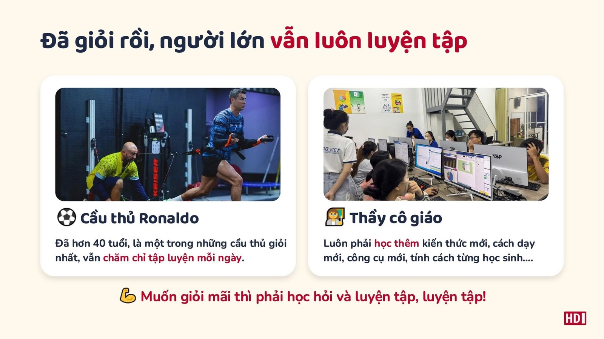

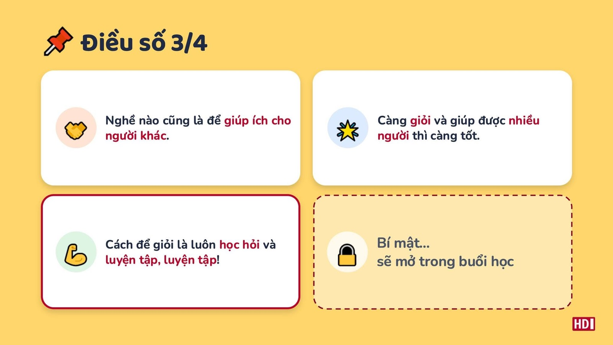

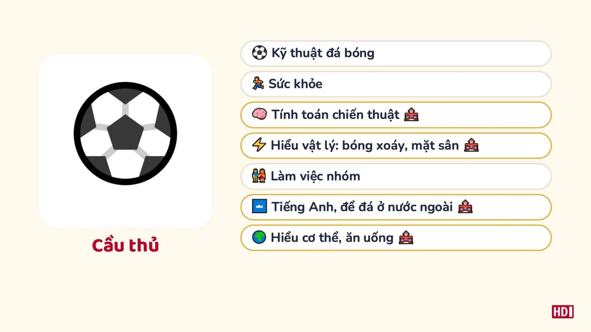

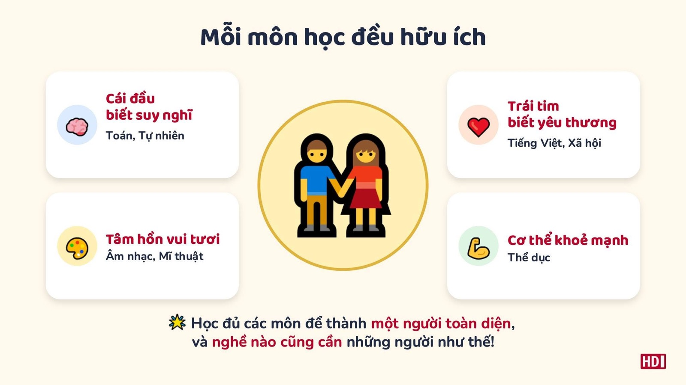

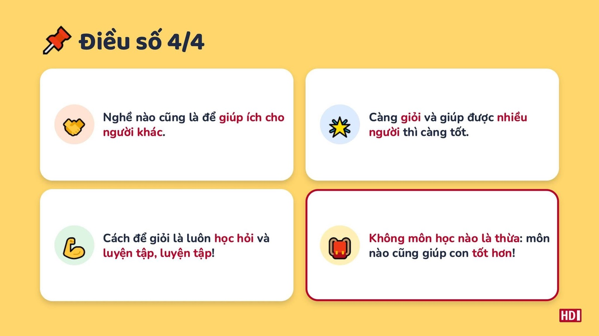

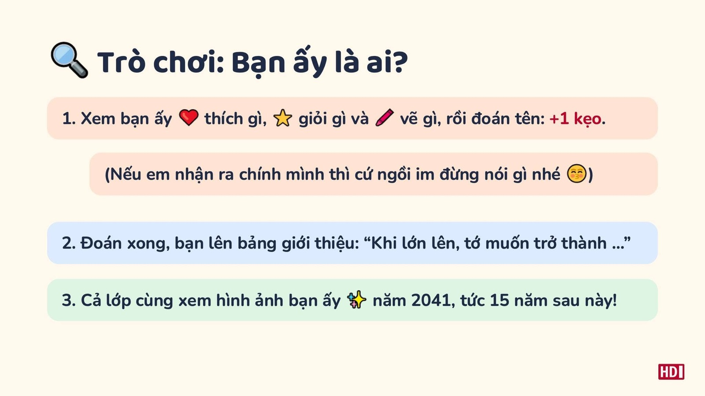

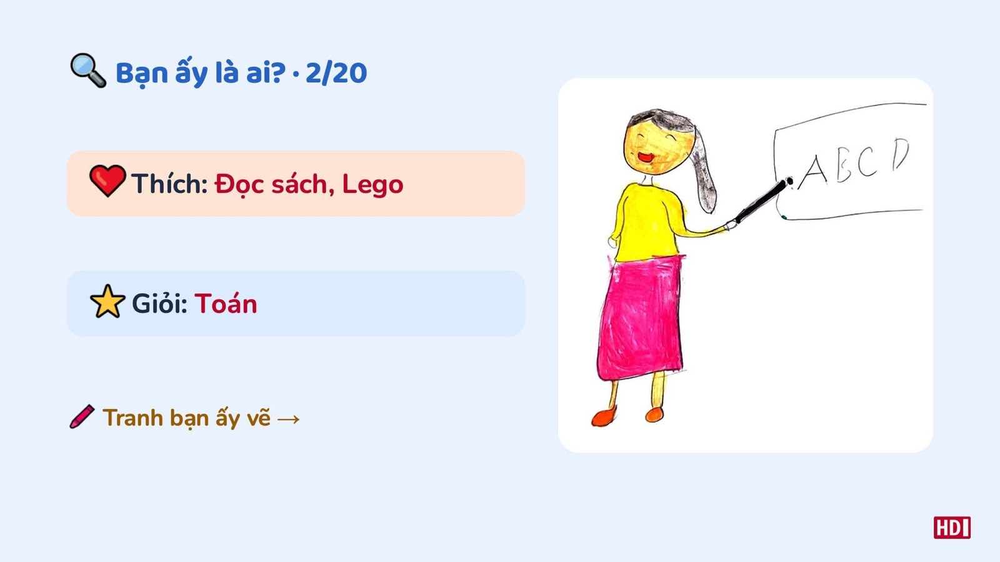

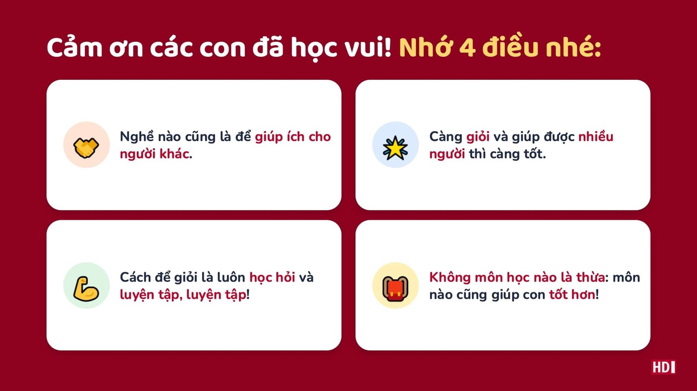

---

P/S: Hơn một tuần sau, ông Dũng nhận thử thách tiếp theo, khó hơn nhiều: dạy "Học cách học" cho các bạn 11 tuổi. Chuyện đó mình kể ở bài [Dạy "Học cách học" cho những bạn nhỏ 11 tuổi như nào bây giờ?](/blog/2026-hoc-cach-hoc/).
