Được giao chủ đề "Ứng dụng công nghệ trong học tập". Người dạy lại phản-đối việc dùng công nghệ và AI trong học tập ở phổ thông. Thế thì dạy kiểu gì????

## Thử thách thứ hai

Vẫn trong chương trình "Cha mẹ cùng thầy cô lên lớp" của Hệ thống giáo dục May Academy. [Buổi trước với lớp 2B0](/blog/2026-mai-nay-em-lon/) (các bạn 7 tuổi) đã đủ đau đầu. Lần này còn đau đầu hơn nhiều.

Lý do thứ nhất: đối tượng là các bạn 11 tuổi, lớp 6B0. Tuổi này "khó chiều" hơn hẳn. Không còn dụ được bằng kẹo nữa.

Lý do thứ hai: chủ đề các bạn "đặt hàng" là "Ứng dụng công nghệ trong học tập". Ý là dùng AI, dùng Canva làm slides đó. Trong khi quan điểm của ông Dũng là phản-đối việc dùng công nghệ và AI trong học tập ở chương trình phổ thông!

Thế là ổng bẻ lái. Chủ đề mới là **"Học cách học"** nói chung, dựa trên trải nghiệm cá nhân và cuốn *Learning How to Learn for Kids and Teens* (Barbara Oakley, Terrence Sejnowski và Alistair McConville).

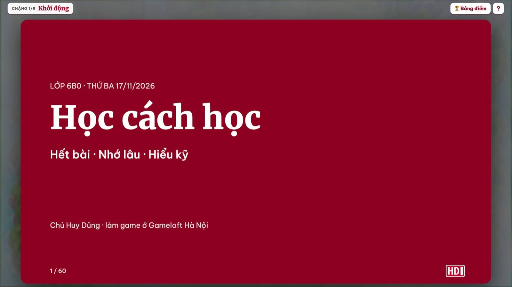

Nhưng bài toán mới lại xuất hiện. Làm sao để bọn trẻ chịu dành 90 phút tiếp thu một chủ đề thoáng-nghe-đã-ngán-và-khô-khan như thế?

---

## Bóc lột AI tận răng

Ờ thì... ờ, thì lôi AI ra, cụ thể là Claude, bóc lột chứ sao. Bào thằng đệ tận răng:

- Dịch full quyển sách ra tiếng Việt
- Tranh luận nảy lửa qua lại để chốt nội dung, cấu trúc buổi học
- Làm một cái website-kiêm-slide-trình-chiếu có một đống tính năng: bản đồ kho báu, nhân vật, vòng xoay may mắn, đồng hồ đếm ngược, tính điểm trắc nghiệm, brainstorm và đính sticky note lên bảng, chỉnh sửa slide trực tiếp...
- Làm 4 video ngắn về các tình huống dùng AI trong học tập
- Làm slides template, vẽ hình minh họa và các tài liệu khác để in ra
- Tất cả mọi thứ được tối ưu hóa nhất có thể cho đúng lớp học này (sĩ số, tính cách...)

**Bạn có thể xem lại toàn bộ website-kiêm-slide đó ở đây: [huydung.com/learn-to-learn-11yo](https://huydung.com/learn-to-learn-11yo)**

Cả buổi học là một chuyến đi qua bản đồ kho báu. Mỗi trạm là một hoạt động: khởi động, đọc hiểu, trả lời, giảng giải, bình chọn, dùng AI, làm slide, chung kết, về đích.

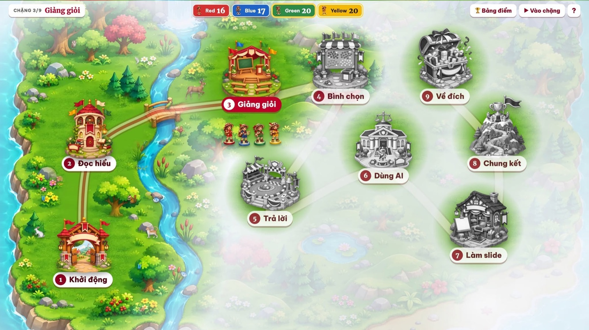

Lớp chia 4 đội Red, Blue, Green, Yellow, có bảng điểm chạy suốt buổi. Trẻ con 11 tuổi có thể chán bài giảng, nhưng thua đội bên cạnh thì không chịu được :D

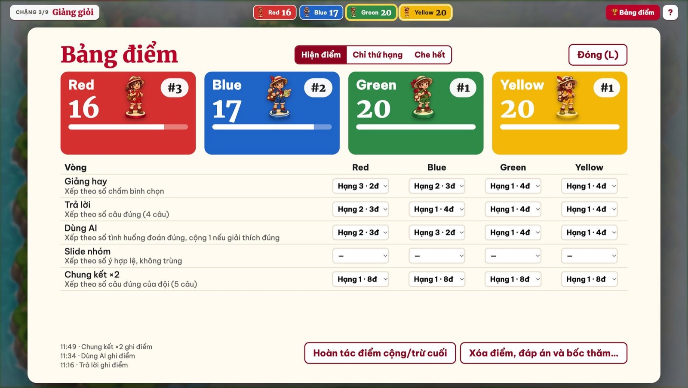

---

## Một vài nội dung trong buổi học

**Bài học 1: Thích trước hay giỏi trước?** Nhiều người nghĩ phải thích một môn thì mới giỏi môn đó. Nhưng rất nhiều khi, thứ tự lại ngược lại: **Tập → Giỏi → Thích**. Chú chơi Clash Royale cũng vậy. Tập trước, giỏi lên, rồi mới thích. Nhiều nghệ sĩ chỉ bắt đầu đam mê môn nghệ thuật của họ sau khi bị "ép" tập lúc còn nhỏ.

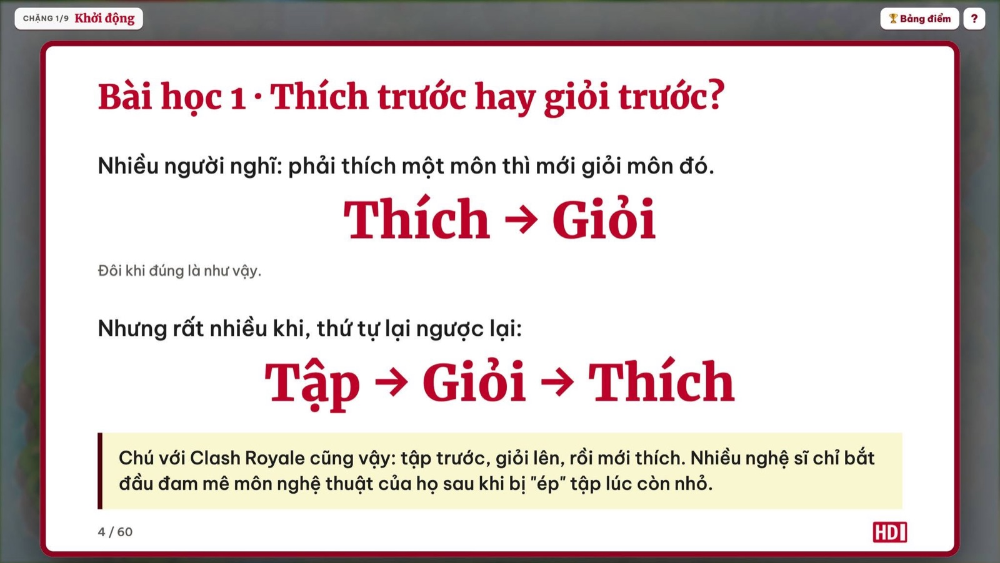

**Bài học 2: Chiếc thang học tập.** Leo càng cao, não càng phải làm việc nhiều, càng nhớ lâu. 4 bậc thang:

1. **Nhận vào:** xem người khác chơi, nghe giảng, đọc lại bài
2. **Làm theo:** bắt chước y hệt video, chép lời giải
3. **Tự chế:** vào trận, tự nghĩ nước đi, tự sắp xếp lại thông tin, tự tóm tắt bằng lời của mình
4. **Tương tác:** cả đội bàn chiến thuật, giảng giải và tranh luận với người khác

Mặc định, ai cũng có xu hướng chỉ học ở những bậc thấp. Nhưng việc học sẽ hiệu quả hơn rất nhiều nếu ta cố leo lên các bậc cao hơn.

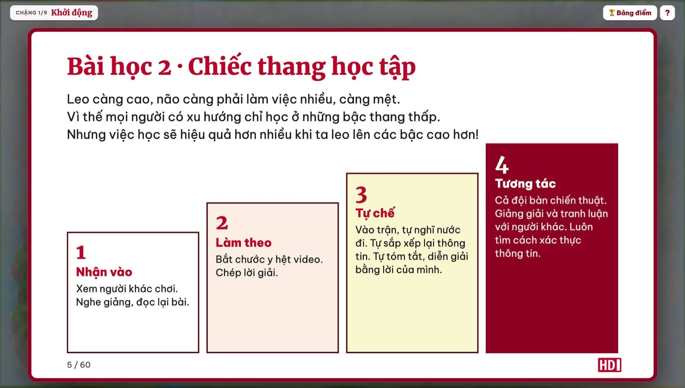

Rồi tới các "hack" học tập, ví dụ **Hack 4: Luyện nhiều chỗ yếu**. Có đồng hồ đếm ngược, các đội úp thẻ xuống và nghe kỹ, vì sau đó sẽ có câu hỏi về hack này.

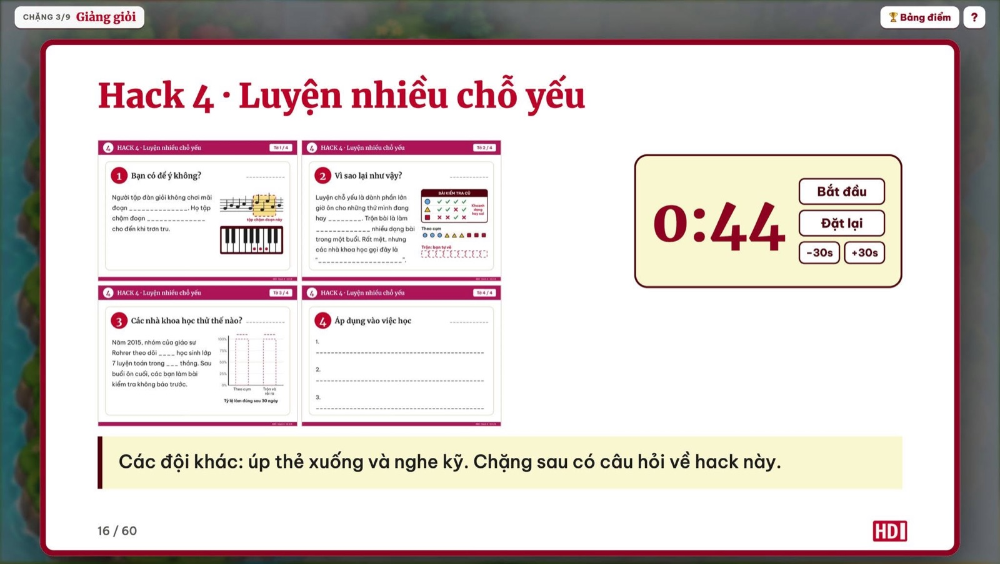

Và cuối cùng, phần các bạn đặt hàng: dùng AI trong học tập. Vòng xoay may mắn bốc thăm tình huống cho từng đội.

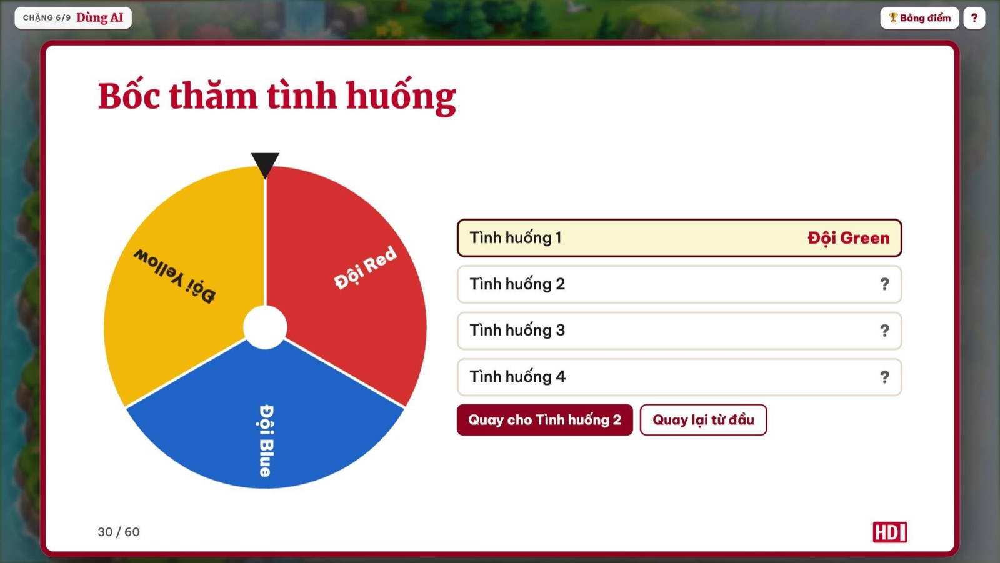

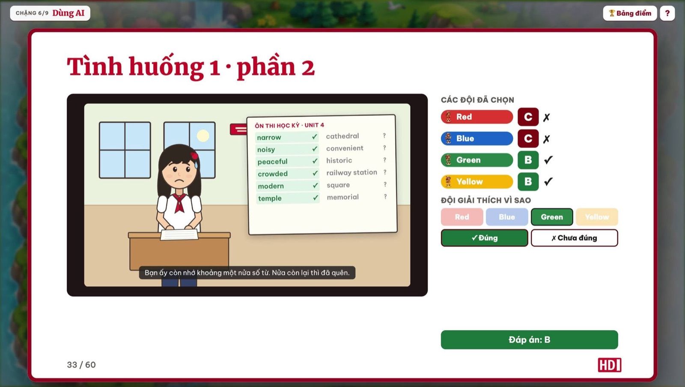

Câu hỏi chốt: An, Bình, Chi và Dũng đều dùng Gemini. An giải xong bài Toán, nhờ Gemini ra thêm 3 bài giống vậy để làm. Bình tự viết 5 ý chính bài Lịch sử, rồi nhờ Gemini xem còn thiếu ý nào. Chi nhờ Gemini viết hộ đoạn mở bài, chép nguyên vào vở. Dũng nhờ Gemini hỏi vặn bài thuyết trình của mình, rồi tự trả lời từng câu.

Vậy những bạn nào đang dùng AI để leo lên cao hơn trên chiếc thang học tập?

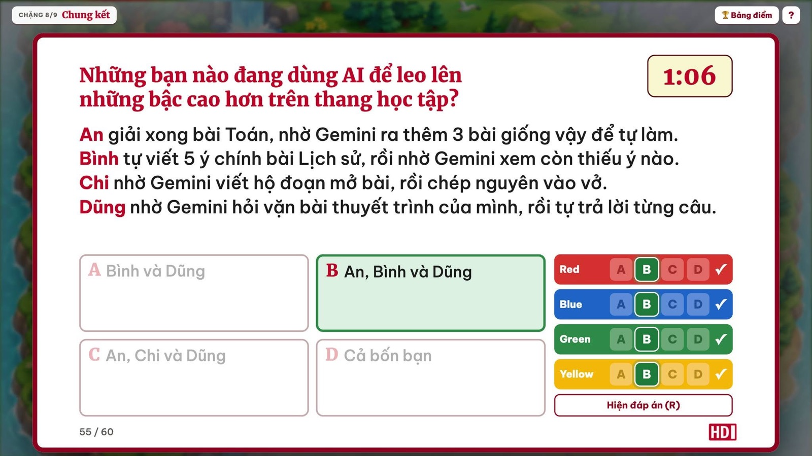

---

## Một mình thì không ai làm thế này

Không một người-bình-thường nào lại đi làm một thứ phức-tạp như thế cho MỘT buổi học duy nhất cả. Tự code thì dễ dàng mất 1 tuần full time.

Nhưng khi có AI thì nó lại trở thành hiện thực được, vì chỉ còn cần 2-3 buổi tối mà thôi. Mê thiệt.

Ê mà không chỉ tui tự làm tự mê nha. Dựa trên nét mặt các bạn nhỏ thì có vẻ các bạn ấy cũng đã rất vui. Và dựa trên các câu trả lời thì các bạn cũng đã khá ngấm.

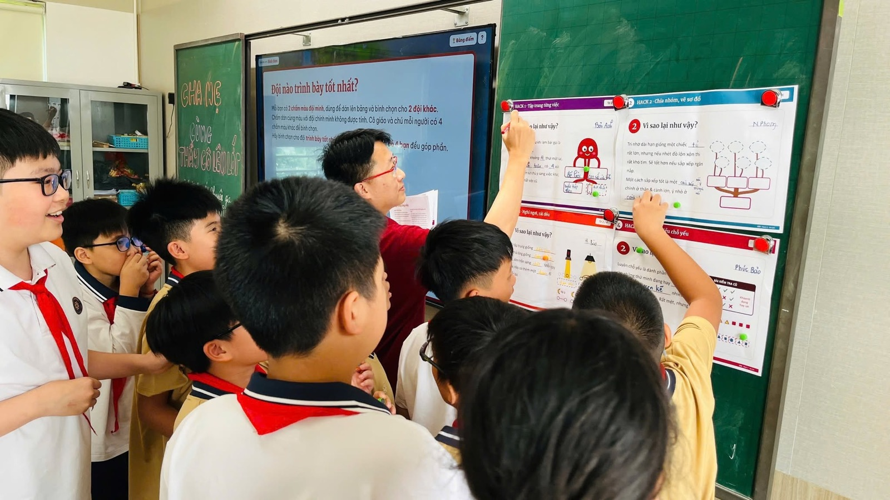

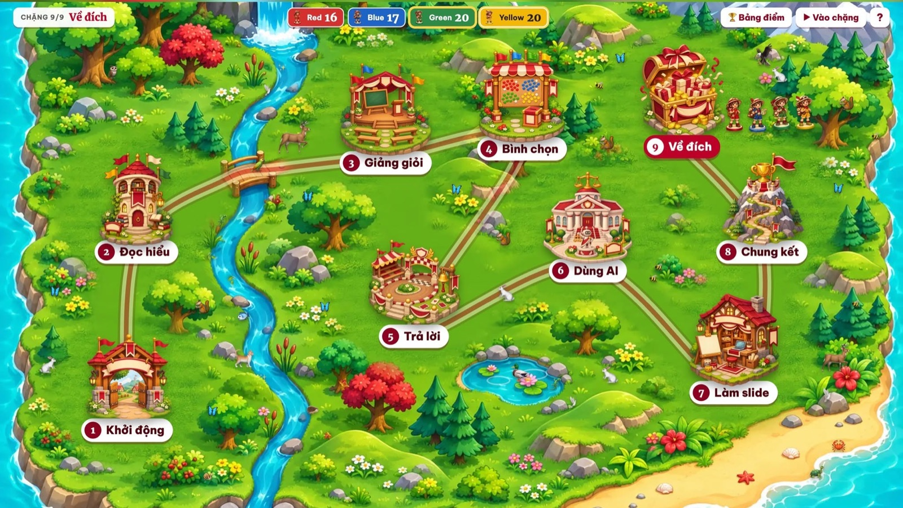

Thank you AI.

---

P/S: Nhưng tôi vẫn phản đối việc để các bạn nhỏ trực tiếp dùng AI trong học tập ở cấp phổ thông nghen. Trừ khi có người đủ chuyên môn, cả về công nghệ lẫn về giáo dục, đồng hành và hướng dẫn.
